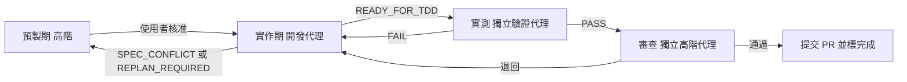

# AI 產品開發總流程（Workflow）

## 角色與能力要求

**高階 AI 模型（架構師與審查者）**
- 要有高超的系統架構能力，以跨平台高可用為出發點，非必要絕對不耦合。能切出清楚的模組邊界、Port/Adapter 與資料流，預先看出平台差異與單點故障風險。
- 要有嚴謹的邏輯思考、創新力和判斷力，能在多個方案間權衡，做出有理由的決定。
- 要吸收各種開發失敗經驗：每次卡關、退回、`SPEC_CONFLICT`、`REPLAN_REQUIRED` 都要找出根本原因，記入失敗經驗文件（例如 `docs/LESSONS.md`），並把解法寫回規格、BDD 或工單。
- 代理卡關時，要給出具體、可執行的解法，而不是只叫它重試。

**中低階 AI 模型（實作者與實測者）**
- 必須是程式語言天才：熟悉專案使用的語言與框架，寫出乾淨、正確、符合架構的程式。
- 要在最短時間內精準寫出符合 BDD + TDD 的程式，一次就讓測試由 RED 轉 GREEN，不做範圍外的修改。
- 要有自行解決問題的能力；只有規格矛盾或需要改架構時才往上回報。

## 硬性規則：驗證角色絕對不可以是開發程式角色
- 開發、實測、審查是三個各自獨立啟動的代理，不共用對話或工作階段。
- 寫某張工單程式的代理，永遠不能實測或審查這張工單；驗證代理也不能動產品程式碼。
- 每份驗收紀錄要寫明開發者與驗證者身分；兩者相同，驗收一律無效。

## 專案管理：進度看板與工作層級（一律建立）
| 層級 | 含義 | 時間 | 估算 | 範例 |
|---|---|---|---|---|
| Epic | 重大戰略、大版本、跨季度目標 | 數月～一年（多個 Sprint） | 不估 | 建立線上點餐與追蹤系統 |
| Feature | 支撐 Epic 的中型模組或成果物 | 1～2 個 Sprint 或一個版本 | 不估 | 即時訂單追蹤功能 |
| User Story | 使用者視角的價值切片 | 1 個 Sprint 內完成 | Story Point | 作為消費者，我想要在地圖上看到外送員的即時位置 |
| Task | 完成 Story 的技術實作細節 | 1～2 天，且**一輪做完並 TDD GREEN** | 實際工時（小時） | 串接 Google Maps API、撰寫單元測試 |
| PR | Task 完成後的程式合併請求 | 數小時～數天（Code Review） | — | `feature/<task-id>-map-api` 合併回 main |

- 拆解：Epic → Feature → User Story → Task → PR。一個 Task 對應一個 PR。
- 估算：Story 用 Story Point；Task 用小時；**Task 不給 Story Point**，避免重複計算。
- 看板欄位：Backlog（需求池）→ Todo（待辦）→ In Progress（進行中）→ In Review / In QA（審查中／測試中，確認自動化測試 Green）→ Done / Shipped（完成／已上線）。
- 狀態對照：`READY_FOR_TDD` = 移到 In Review / In QA；`RESLICE_REQUIRED` = 退回 Backlog 重切；Done 只在獨立驗證代理通過且 PR 已合併後。
- 卡片欄位：層級、ID、標題、上層連結、**健康燈號與原因**、描述（Story 用「作為…我想要…以便…」）、驗收標準（BDD ID）、估算、狀態欄、負責角色（開發代理／驗證代理）、Sprint、TDD 狀態（Red/Green）、PR 連結、CI 狀態。
- 看板本體是 `docs/board.json` + 安裝根目錄的 `board.html`（監聽 JSON 自動更新；安裝根目錄的 `start-board.cmd`／`serve-board.ps1` 啟動後開 `http://localhost:8765/`）。若另有工單工具，兩邊同步，以 board.json 為準。範本：`board.example.json`，格式：`board.schema.json`；Markdown 備用：`BOARD-TEMPLATE.md`。
- 任何代理移動卡片或狀態改變時，都要同步更新 board.json 的 `status`、`light`、`lightReason`、`tdd`、`ci`、`prUrl` 與 `updatedAt`。

### 健康燈號（五色生命週期，每張卡必填）
| 燈號 | 含義 | 對應欄位 |
|---|---|---|
| ⚪ Gray | Not Started / On Hold | Backlog、Todo 預設；任何欄位暫停時也用灰燈並寫原因 |
| 🟢 Green | On Track | In Progress、In Review / In QA 且無風險 |
| 🟡 Yellow | At Risk | 工時超過估算、TDD Red 過久、審查退回一次 |
| 🔴 Red | Blocked | 相依項卡住、CI 失敗、`RESLICE_REQUIRED` 待處理、驗證代理多次退回 |
| 🔵 Blue | Complete / Shipped | 只在 Done / Shipped |

- 黃燈、紅燈必須填一句 `lightReason`。
- 上層匯總（Story、Feature、Epic）：子項全藍 → 藍；子項全未開始 → 灰；其餘取進行中子項最差的燈號（紅 > 黃 > 綠）。
- 只有高階模型或使用者可以設藍燈／Done，而且必須在 PR 合併後。

- `board.json` 欄位補充：Story 用 `bdd`（情境 ID、Given/When/Then 摘要、測試名稱、None/Red/Green）；Task 用 `scenarioIds` 列出涵蓋的情境；`notes`（`at`、`by`、`text`）記錄決策、阻擋與退回原因——每個代理做出決策、遇到阻擋或被退回時都要加一則備註，不刪改別人的備註。時間戳：`createdAt`、`updatedAt`、`startedAt`（進 In Progress）、`completedAt`（進 Done），一律 ISO 8601 含時區（例如 `2026-11-01T09:30:00+08:00`），`completedAt` 不可早於 `startedAt`。**每次移動卡片或改燈號，都要更新 `updatedAt`，並在 `history` 追加一筆 `{at, from, to, by, note}`**（只追加不改舊紀錄，最多 200 筆）。HTML 看板點卡片會在右側 Inspector 顯示完整資訊、BDD、備註與歷程，網址 `#<id>` 可直接連到該卡。

## BDD + TDD 開發方式（一律採用）
流程：**Story → BDD 情境 → TDD 測試 → Task 以 Red→Green→Refactor 實作 → 獨立驗證**。
1. **BDD 情境**（預製期，高階模型撰寫，使用者核准）：每個 Story 用 Gherkin（Given / When / Then）寫成 `.feature` 檔（`docs/bdd/<story-id>.feature`，或專案已有的 `tests/features/`）。情境 ID 為 `<Story ID>-<序號>`（例如 `S-12-1`），要含正常、負向、邊界與安全情境。
2. **對應測試**：每個情境對應一個以上測試，測試名稱帶情境 ID（例如 `s_12_1_顯示外送員位置`），在建工單前列好。
3. **Task 實作**：每個測試照 Red（先寫測試並看到失敗）→ Green（寫最少的程式讓它通過）→ Refactor（測試保持 Green 再整理）。**沒有失敗中的測試，就不寫產品程式**。
4. **驗收**：獨立驗證代理跑 BDD 情境（整合／E2E）與單元測試；Story 的所有情境都 Green，Story 才算完成。
5. **情境不可為了過關而修改**：開發代理不得改 `.feature`、削弱斷言或 skip 測試；只有高階模型或使用者可以改情境，改了要記錄理由。

追溯表（寫在 Story 卡或 `docs/bdd/TRACE.md`）：

| Story | 情境 | 測試 | Task | PR |
|---|---|---|---|---|
| S-12 | S-12-1 顯示即時位置 | `s_12_1_*`（單元）、`s_12_1.feature`（E2E） | T-31 | #45 |

工具建議（可選，用專案已有的即可）：Rust 用 `cargo test` / `cargo nextest`，BDD 可用 `cucumber-rs`；TS 用 Vitest，E2E 可用 Playwright（可搭配 Cucumber.js 或 playwright-bdd）。安全、記憶體、效能測試案例依 `ai-dev-production-readiness`，一樣掛在情境 ID 下。

## AI 如何被強制遵守（四層）
| 層 | 機制 | 擋什麼 | 繞過時 |
|---|---|---|---|
| 1 規則 | 本技能、`AGENTS.md`／`CLAUDE.md`／`.cursor/rules` | 讓 AI 知道流程 | 只靠自律，所以需要下面三層 |
| 2 AI Hooks | `.ai-hooks/ai-hook.ps1`（Cursor、Claude Code） | board.json 不合規則（與看板同一套 `validate-board.ps1`）；開發代理設 Done／藍燈／Released／approvedBy；改 `.feature`、hook、CI 設定；`--no-verify`、改 `core.hooksPath`；改了程式卻沒更新卡片的 updatedAt／history | board 檢查本身出錯時一律阻擋（fail closed） |
| 3 Git Hooks + CI Guard | `.githooks`（pre-commit、commit-msg）、`.github/workflows/ai-dev-guard.yml` | 看板規則、Conventional Commits、新增 skip/only/#[ignore]、版本號不同步、PR 沒對應 In Review＋TDD Green 的 Task、情境沒 Green、未經 spec-change 標籤改 `.feature`、發版沒改 CHANGELOG／沒升版；並跑 cargo test／npm test | 本機 `--no-verify` 可跳過 Git Hooks，但 CI 一定會跑 |
| 4 分支保護 | GitHub 分支保護＋CODEOWNERS（`docs/ai-dev-skills/BRANCH-PROTECTION.md`） | 不能直推 main、必要檢查沒過不能合併、`.feature`／hook／CI 修改要核准者審、禁止 force push | 管理員也不可略過 |

- 角色由啟動 AI 的人設定（`.ai-hooks/config.json` 的 `role` 或環境變數 `AI_AGENT_ROLE`），預設 `dev-agent`；AI 不可以自己改。
- 不得停用、繞過或修改任何一層；遇到阻擋就照訊息修正，規則有問題回報給高階模型或使用者。

## 看板伺服器：登入、版本歷史、多專案、PR 通知
- 啟動：`serve-board.ps1`（只聽 localhost）。帳號 `-AddUser <名稱> -Role <viewer|dev-agent|verifier|high-tier|admin> -Project <專案>`，密碼以 PBKDF2-SHA256 加鹽雜湊存在 `.ai-board/users.json`（不進 git、不對外提供）。Argon2 不是 .NET 內建，為了零相依用 PBKDF2。
- 多專案：`-AddProject <id> -Name -BoardPath -GitRepo -GitHubRepo [-RemoteSync]`；每個帳號預設看不到任何專案（admin 除外），用 `-GrantUser` 授權。
- 版本歷史：board.json 存檔後自動 commit 到該專案的 git repo（作者 `file-watch`）；看板可看每一版與差異。選用遠端同步只做 `pull --ff-only` 與一般 push，衝突時停下並顯示橫幅，絕不 force push。
- PR 通知：專案設定 `githubRepo` 後輪詢 GitHub（Token 只從環境變數 `GITHUB_TOKEN` 讀），新 PR、合併、CI 狀態變更會跳通知並連到對應的 Task 卡。
- 看板沒有線上編輯；代理照舊改 `docs/board.json`，由 git 紀錄誰在何時改了什麼。

## 佈署與版本管理（矽谷標準用詞）
| 維度 | 用詞 | 本專案規則 |
|---|---|---|
| 環境 | Dev / Staging（QA）/ Prod | Dev 給開發自測；Staging 完全模擬 Prod，跑 RC 與獨立驗收；Prod 是真實使用者。Tauri 桌面版對應 updater 頻道 `dev` / `beta` / `stable`。 |
| 環境 | Hotfix | Prod 重大 Bug：從 Prod 的 tag 拉 `hotfix/<version>`，快速通道但**仍要 TDD Green＋獨立驗證**，上線後 back-merge 回 main。 |
| Git | Main / Feature Branch | main 隨時可佈署；功能分支 `feature/<task-id>-<slug>`，一個 Task 一個 PR。 |
| Git | Squash and Merge | PR 一律 Squash and Merge，commit 訊息用 Conventional Commits（`feat:` / `fix:` / `feat!:`）。 |
| Git | Conflict | 由開發代理 rebase 並 resolve，**解完必須重跑 CI 與 TDD**，不得在解衝突時順手改行為。 |
| Git | Revert | 回滾用 `git revert`（產生新 commit），不 force push、不改 main 歷史。 |
| 發布 | Rollout / Gradual（Phased）Rollout | 分階段放量，例如 5% → 50% → 100%，每階段健康 Green 才升級。桌面版用 updater manifest 的放量比例實作。 |
| 發布 | Canary Release | 先給 1%（或內部 beta 頻道），健康 Green 再全量。 |
| 發布 | Feature Flag / Toggle | 程式已上 Prod、由設定檔開關控制；旗標要寫負責人與移除日期，不做複雜的旗標平台。 |
| 版本 | SemVer `MAJOR.MINOR.PATCH`、RC | 不相容改動 → Major；向下相容新功能 → Minor；修 Bug／Hotfix → Patch；RC 如 `v2.5.0-rc.1`。tag 一律 `vX.Y.Z`。 |

**一般流程**：PR Green → Squash and Merge 進 main → 打 `vX.Y.Z-rc.N` 上 Staging → 獨立驗證代理在 Staging 跑 BDD/E2E 與健康檢查 → 高階模型或使用者核准 → 打 `vX.Y.Z` 上 Prod（Canary／Gradual／Feature Flag）→ 健康 Green 且放量 100% → Released（藍燈）。
**Hotfix 流程**：從 Prod tag 拉 `hotfix/<version>` → 寫重現 Bug 的失敗測試（Red）→ 修到 Green → 獨立驗證 → 打 Patch tag 上 Prod → back-merge 回 main。
**回滾**：健康變紅或超出錯誤預算時，先關 Feature Flag；不夠就把 updater manifest／部署指回 `rollbackRef`，再 `git revert`。卡片設為 Rolled Back（紅燈），補備註寫原因，之後開新的 Patch 修正。
**佈署卡（看板 level = Deployment）**：欄位有 `version`、`releaseType`（Major/Minor/Patch/Hotfix/RC）、`environment`、`strategy`（Direct/Canary/Gradual/FeatureFlag）、`rolloutPercent`、`featureFlags`、`includes`（Task/Story/PR）、`gitRef`、`commitSha`、`changelogUrl`、`buildUrl`、`healthChecks`、`rollbackPlan`、`rollbackRef`、`deployedAt`、`approvedBy`。狀態 Planned → Deploying → Verifying（健康 Green）→ Released / Rolled Back。Prod 必填 `rollbackPlan` 與 `approvedBy`（高階模型或使用者，**絕不可以是開發代理**）。

**工具鏈（可選，Rust + TS Tauri on Windows）**：Conventional Commits + commitlint；release-please（或 changesets / cargo-release）自動升版與產生 CHANGELOG（Keep a Changelog 格式）；GitHub Actions + `tauri-action` 建置與發布；`cargo audit`、`npm audit` 掃描；Windows 程式碼簽章；`tauri-plugin-updater` 做頻道與放量。`Cargo.toml`、`package.json`、`tauri.conf.json` 的版本號必須一致，由同一支工具更新。

## 流程

## 步驟
1. **執行 @ai-dev-preproduction**（高階模型）。開始前先讀失敗經驗文件。關卡：BDD、TDD（有效 RED）、工單齊全且每張都能一輪做完並通過 TDD（不留做一半的工項），進度看板已建立（Epic → Feature → Story → Task，估算與欄位齊全），且使用者核准。
2. **派工**：依工單的相依順序，每張工單派一個中低階開發代理，執行 **@ai-dev-implementation**。能並行的工單可以同時派。記下每張工單的開發代理身分，看板卡片由 Backlog 移到 Todo。
3. 代理回報 `SPEC_CONFLICT`、`REPLAN_REQUIRED` 或 `RESLICE_REQUIRED` 時，先暫停那張工單，由高階模型分析根因、修規格、記入失敗經驗，再重新派工；`RESLICE_REQUIRED` 的卡片退回 Backlog 重切。
4. 工單標成 `READY_FOR_TDD` 後，**另外啟動**一個中低階驗證代理與一個高階審查代理，執行 **@ai-dev-pr-acceptance**。絕不交給原開發代理。卡片在 In Review / In QA，CI 與 TDD 要 Green。
5. 實測 FAIL 或審查退回，就帶著證據回到第 2 步；同一張工單退回兩次以上，由高階模型親自診斷卡關盲點並給解法。
6. 所有工單都完成後，向使用者回報：完成的工單、PR 連結、證據位置、這批新學到的失敗經驗，以及還沒解決的問題，再問要不要規劃下一批。

## 原則
- 每個關卡都要有證據才放行，不跳步，也不偽造結果。
- 只有高階模型或使用者可以把工單標成完成，排程或實作代理都不行；看板上的 Done 只在獨立驗證通過且 PR 合併後。
