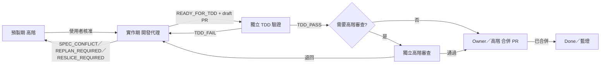

# AI 開發主索引

> 這份是**唯一必讀**。下面「路由表」列的參考文件，只有做到那一步才去讀。
> 專案事實（技術棧、路徑、看板位置）以 [references/project.md](../.agents/skills/ai-dev-pipeline/references/project.md) 為準；通用原則與專案事實衝突時，以專案事實為準並回報。

## 一、不變原則（任何階段都成立）
1. **驗證者 ≠ 開發者**：寫程式的代理永遠不能實測、審查或核可自己的卡。驗證代理不改產品程式。每份驗收紀錄寫明兩者身分，相同即無效。
2. **有證據才放行**：每個關卡都要可指認的產出與測試輸出；不跳步、不偽造。未執行的檢查記 `NOT RUN`（非失敗、亦非通過）。
3. **不留半成品**：一張 Task 一輪做完且 TDD 全 Green，否則回報 `RESLICE_REQUIRED`；半成品不合併。
4. **情境不為過關而改**：開發代理不改 `.feature`、不削弱斷言、不加 skip、不寫死回傳值。
5. **依賴只由外往內**：領域層零框架／平台依賴；平台差異一律經 Port/Adapter。耦合要寫得出「為什麼必要」。
6. **不過度設計**：只做需求與 BDD 要求的；沒有量測不優化；沒有第二種實作不抽象。
7. **只讀自己的卡**：代理只讀被指派的卡、它的 Story/BDD、允許路徑與失敗經驗文件，不掃整個看板或專案。
8. **不繞過強制機制**：hook、Git hook、CI、分支保護一律不停用、不改寫指令繞過；被擋就修正或交給使用者。
9. **失敗要變成經驗**：卡關、退回、`SPEC_CONFLICT`、`REPLAN_REQUIRED` 找出根因，記入失敗經驗文件（預設 `docs/LESSONS.md`，沒有就建立），並寫回規格或工單。

## 二、流程主線

| 階段 | 執行者 | 入口 skill | 出關條件 |
|---|---|---|---|
| 預製期 | 高階模型 | `ai-dev-preproduction` | 需求、UI/UX、架構、Story、BDD、TDD 封包、工單、看板齊全，使用者核准 |
| 實作期 | 開發代理（一卡一代理） | `ai-dev-implementation` | 本卡 TDD 全 Green、自我審查完成、draft PR、卡片 In Review |
| 驗收期 | 獨立 TDD 代理（＋必要時高階審查） | `ai-dev-pr-acceptance` | `TDD_PASS`（＋審查通過）、PR 合併 |

## 三、狀態碼
| 代碼 | 誰發 | 意思 | 後續 |
|---|---|---|---|
| `READY_FOR_TDD` | 開發代理 | 本卡完成、TDD 自測 Green | 卡到 In Review，另起驗證代理 |
| `TDD_PASS` / `TDD_FAIL` | 獨立 TDD 代理 | 重跑與實測結果 | PASS → 合併；FAIL → 退回實作 |
| `SPEC_CONFLICT` | 開發代理 | 規格互相矛盾 | 暫停，高階模型修規格 |
| `REPLAN_REQUIRED` | 開發代理 | 需新介面、跨層或改架構 | 暫停，回預製期 |
| `RESLICE_REQUIRED` | 開發代理 | 一輪做不完 | 卡退回 Backlog 重切 |

同一張卡退回兩次以上，由高階模型親自診斷並給具體解法，不只叫它重試。

## 四、路由表：什麼時候讀哪一份
| 你正在… | 讀 |
|---|---|
| 確認角色、誰開 PR、誰能設 Done、何時要高階審查 | [references/roles-and-gates.md](../.agents/skills/ai-dev-pipeline/references/roles-and-gates.md) |
| 建卡、移卡、設燈號、寫 notes/history | [references/board-and-lights.md](../.agents/skills/ai-dev-pipeline/references/board-and-lights.md) |
| 寫 BDD 情境、TDD 封包、RED 證據、追溯表 | [references/bdd-tdd.md](../.agents/skills/ai-dev-pipeline/references/bdd-tdd.md) |
| 選架構、切分層、定 Port/Adapter、資料流 | [references/architecture.md](../.agents/skills/ai-dev-pipeline/references/architecture.md) |
| 設計畫面與流程 | [references/ux.md](../.agents/skills/ai-dev-pipeline/references/ux.md) |
| 寫程式、自我審查、審查程式品質 | [references/coding-standards.md](../.agents/skills/ai-dev-pipeline/references/coding-standards.md) |
| 處理效能、演算法、複雜度、benchmark | [references/performance.md](../.agents/skills/ai-dev-pipeline/references/performance.md) |
| 測試策略、交易與併發、日誌、安全、記憶體 | [references/readiness.md](../.agents/skills/ai-dev-pipeline/references/readiness.md) |
| 分支、commit、版本、發布、Hotfix、回滾 | [references/release.md](../.agents/skills/ai-dev-pipeline/references/release.md) |
| hook 被擋、CI guard、分支保護、看板伺服器 | [references/enforcement.md](../.agents/skills/ai-dev-pipeline/references/enforcement.md) |
| 本專案技術棧、路徑、證據位置、命名慣例 | [references/project.md](../.agents/skills/ai-dev-pipeline/references/project.md) |
| 為 Phase 1 業務邏輯（M01–M08）或 UI/UX 參數寫測試、驗收重跑 | [ai-dev-product-tests](../.agents/skills/ai-dev-product-tests/SKILL.md)（再依對照表只讀一份模組參考） |

## 五、派工步驟（高階模型／Owner）
1. 執行 `ai-dev-preproduction`；開始前先讀失敗經驗文件。
2. 依相依順序，每張 Task 派一個開發代理執行 `ai-dev-implementation`；可並行的同時派。prompt 只放該卡摘錄（id、BDD、TDD 封包、允許／保護範圍）。記下開發代理身分。
3. 收到 `SPEC_CONFLICT`／`REPLAN_REQUIRED`／`RESLICE_REQUIRED`：暫停該卡，分析根因、修規格、記經驗，再重派。
4. 收到 `READY_FOR_TDD`：**另起**驗證代理執行 `ai-dev-pr-acceptance`；符合條件時再另起高階審查代理。
5. 全部完成後向使用者回報：完成的卡、PR 連結、證據位置、新學到的失敗經驗、未解問題，並問是否規劃下一批。
