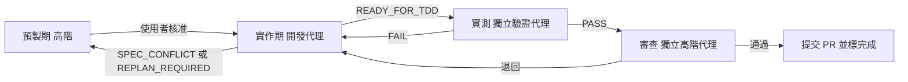

# AI 開發流程規則（AI Dev Skills）

> 由 AI Dev Skills 安裝程式產生。驗證角色絕對不可以是開發程式角色。

## 技能索引
- **ai-dev-pipeline**：總流程（workflow）：當要用 AI 代理把一個產品或功能從規劃一路做到 PR 時使用，依序串起預製期、實作期、PR 驗收期三個Skill，並設好階段之間的關卡。
- **ai-dev-preproduction**：預製期（高階 AI模型）：當要從零規劃一個產品或新功能時使用，依序產出需求、UI/UX、架構骨架、Stories/Epics、BDD、TDD、工單，並輸入使用者慣用的工單工具。
- **ai-dev-implementation**：實作期（中低階 AI 模型）：當要依已核准的工單、Stories/Epics 與 BDD 實作一張工單時使用。
- **ai-dev-pr-acceptance**：PR 驗收期（中低階 AI 模型實測，高階 AI 模型審查）：當工單標成 READY_FOR_TDD，要依 TDD 實際操作介面驗證、截圖錄影，並審查提交PR 時使用。
- **ai-dev-production-readiness**：上線就緒標準：規劃、實作或審查程式時，要確認測試策略、資料一致性與併發、可觀測性、安全防禦是否到位時使用；由ai-dev-preproduction、ai-dev-implementation、ai-dev-pr-acceptance 引用。

---

<!-- skill: ai-dev-pipeline -->
# AI 產品開發總流程（Workflow）

## 角色與能力要求

**高階 AI 模型（架構師與審查者）**
- 要有高超的系統架構能力，以跨平台高可用為出發點，非必要絕對不耦合。能切出清楚的模組邊界、Port/Adapter 與資料流，預先看出平台差異與單點故障風險。
- 要有嚴謹的邏輯思考、創新力和判斷力，能在多個方案間權衡，做出有理由的決定。
- 要吸收各種開發失敗經驗：每次卡關、退回、`SPEC_CONFLICT`、`REPLAN_REQUIRED` 都要找出根本原因，記入失敗經驗文件（例如 `docs/LESSONS.md`），並把解法寫回規格、BDD 或工單。
- 代理卡關時，要給出具體、可執行的解法，而不是只叫它重試。

**中低階 AI 模型（實作者與實測者）**
- 必須是程式語言天才：熟悉專案使用的語言與框架，寫出乾淨、正確、符合架構的程式。
- 要在最短時間內精準寫出符合 BDD + TDD 的程式，一次就讓測試由 RED 轉 GREEN，不做範圍外的修改。
- 要有自行解決問題的能力；只有規格矛盾或需要改架構時才往上回報。

## 硬性規則：驗證角色絕對不可以是開發程式角色
- 開發、實測、審查是三個各自獨立啟動的代理，不共用對話或工作階段。
- 寫某張工單程式的代理，永遠不能實測或審查這張工單；驗證代理也不能動產品程式碼。
- 每份驗收紀錄要寫明開發者與驗證者身分；兩者相同，驗收一律無效。

## 專案管理：進度看板與工作層級（一律建立）
| 層級 | 含義 | 時間 | 估算 | 範例 |
|---|---|---|---|---|
| Epic | 重大戰略、大版本、跨季度目標 | 數月～一年（多個 Sprint） | 不估 | 建立線上點餐與追蹤系統 |
| Feature | 支撐 Epic 的中型模組或成果物 | 1～2 個 Sprint 或一個版本 | 不估 | 即時訂單追蹤功能 |
| User Story | 使用者視角的價值切片 | 1 個 Sprint 內完成 | Story Point | 作為消費者，我想要在地圖上看到外送員的即時位置 |
| Task | 完成 Story 的技術實作細節 | 1～2 天，且**一輪做完並 TDD GREEN** | 實際工時（小時） | 串接 Google Maps API、撰寫單元測試 |
| PR | Task 完成後的程式合併請求 | 數小時～數天（Code Review） | — | `feature/<task-id>-map-api` 合併回 main |

- 拆解：Epic → Feature → User Story → Task → PR。一個 Task 對應一個 PR。
- 估算：Story 用 Story Point；Task 用小時；**Task 不給 Story Point**，避免重複計算。
- 看板欄位：Backlog（需求池）→ Todo（待辦）→ In Progress（進行中）→ In Review / In QA（審查中／測試中，確認自動化測試 Green）→ Done / Shipped（完成／已上線）。
- 狀態對照：`READY_FOR_TDD` = 移到 In Review / In QA；`RESLICE_REQUIRED` = 退回 Backlog 重切；Done 只在獨立驗證代理通過且 PR 已合併後。
- 卡片欄位：層級、ID、標題、上層連結、**健康燈號與原因**、描述（Story 用「作為…我想要…以便…」）、驗收標準（BDD ID）、估算、狀態欄、負責角色（開發代理／驗證代理）、Sprint、TDD 狀態（Red/Green）、PR 連結、CI 狀態。
- 看板本體是 `docs/board.json` + 安裝根目錄的 `board.html`（監聽 JSON 自動更新；安裝根目錄的 `start-board.cmd`／`serve-board.ps1` 啟動後開 `http://localhost:8765/`）。若另有工單工具，兩邊同步，以 board.json 為準。範本：`board.example.json`，格式：`board.schema.json`；Markdown 備用：`BOARD-TEMPLATE.md`。
- 任何代理移動卡片或狀態改變時，都要同步更新 board.json 的 `status`、`light`、`lightReason`、`tdd`、`ci`、`prUrl` 與 `updatedAt`。

### 健康燈號（五色生命週期，每張卡必填）
| 燈號 | 含義 | 對應欄位 |
|---|---|---|
| ⚪ Gray | Not Started / On Hold | Backlog、Todo 預設；任何欄位暫停時也用灰燈並寫原因 |
| 🟢 Green | On Track | In Progress、In Review / In QA 且無風險 |
| 🟡 Yellow | At Risk | 工時超過估算、TDD Red 過久、審查退回一次 |
| 🔴 Red | Blocked | 相依項卡住、CI 失敗、`RESLICE_REQUIRED` 待處理、驗證代理多次退回 |
| 🔵 Blue | Complete / Shipped | 只在 Done / Shipped |

- 黃燈、紅燈必須填一句 `lightReason`。
- 上層匯總（Story、Feature、Epic）：子項全藍 → 藍；子項全未開始 → 灰；其餘取進行中子項最差的燈號（紅 > 黃 > 綠）。
- 只有高階模型或使用者可以設藍燈／Done，而且必須在 PR 合併後。

- `board.json` 欄位補充：Story 用 `bdd`（情境 ID、Given/When/Then 摘要、測試名稱、None/Red/Green）；Task 用 `scenarioIds` 列出涵蓋的情境；`notes`（`at`、`by`、`text`）記錄決策、阻擋與退回原因——每個代理做出決策、遇到阻擋或被退回時都要加一則備註，不刪改別人的備註。時間戳：`createdAt`、`updatedAt`、`startedAt`（進 In Progress）、`completedAt`（進 Done），一律 ISO 8601 含時區（例如 `2026-11-01T09:30:00+08:00`），`completedAt` 不可早於 `startedAt`。**每次移動卡片或改燈號，都要更新 `updatedAt`，並在 `history` 追加一筆 `{at, from, to, by, note}`**（只追加不改舊紀錄，最多 200 筆）。HTML 看板點卡片會在右側 Inspector 顯示完整資訊、BDD、備註與歷程，網址 `#<id>` 可直接連到該卡。

## BDD + TDD 開發方式（一律採用）
流程：**Story → BDD 情境 → TDD 測試 → Task 以 Red→Green→Refactor 實作 → 獨立驗證**。
1. **BDD 情境**（預製期，高階模型撰寫，使用者核准）：每個 Story 用 Gherkin（Given / When / Then）寫成 `.feature` 檔（`docs/bdd/<story-id>.feature`，或專案已有的 `tests/features/`）。情境 ID 為 `<Story ID>-<序號>`（例如 `S-12-1`），要含正常、負向、邊界與安全情境。
2. **對應測試**：每個情境對應一個以上測試，測試名稱帶情境 ID（例如 `s_12_1_顯示外送員位置`），在建工單前列好。
3. **Task 實作**：每個測試照 Red（先寫測試並看到失敗）→ Green（寫最少的程式讓它通過）→ Refactor（測試保持 Green 再整理）。**沒有失敗中的測試，就不寫產品程式**。
4. **驗收**：獨立驗證代理跑 BDD 情境（整合／E2E）與單元測試；Story 的所有情境都 Green，Story 才算完成。
5. **情境不可為了過關而修改**：開發代理不得改 `.feature`、削弱斷言或 skip 測試；只有高階模型或使用者可以改情境，改了要記錄理由。

追溯表（寫在 Story 卡或 `docs/bdd/TRACE.md`）：

| Story | 情境 | 測試 | Task | PR |
|---|---|---|---|---|
| S-12 | S-12-1 顯示即時位置 | `s_12_1_*`（單元）、`s_12_1.feature`（E2E） | T-31 | #45 |

工具建議（可選，用專案已有的即可）：Rust 用 `cargo test` / `cargo nextest`，BDD 可用 `cucumber-rs`；TS 用 Vitest，E2E 可用 Playwright（可搭配 Cucumber.js 或 playwright-bdd）。安全、記憶體、效能測試案例依 `ai-dev-production-readiness`，一樣掛在情境 ID 下。

## AI 如何被強制遵守（四層）
| 層 | 機制 | 擋什麼 | 繞過時 |
|---|---|---|---|
| 1 規則 | 本技能、`AGENTS.md`／`CLAUDE.md`／`.cursor/rules` | 讓 AI 知道流程 | 只靠自律，所以需要下面三層 |
| 2 AI Hooks | `.ai-hooks/ai-hook.ps1`（Cursor、Claude Code） | board.json 不合規則（與看板同一套 `validate-board.ps1`）；開發代理設 Done／藍燈／Released／approvedBy；改 `.feature`、hook、CI 設定；`--no-verify`、改 `core.hooksPath`；改了程式卻沒更新卡片的 updatedAt／history | board 檢查本身出錯時一律阻擋（fail closed） |
| 3 Git Hooks + CI Guard | `.githooks`（pre-commit、commit-msg）、`.github/workflows/ai-dev-guard.yml` | 看板規則、Conventional Commits、新增 skip/only/#[ignore]、版本號不同步、PR 沒對應 In Review＋TDD Green 的 Task、情境沒 Green、未經 spec-change 標籤改 `.feature`、發版沒改 CHANGELOG／沒升版；並跑 cargo test／npm test | 本機 `--no-verify` 可跳過 Git Hooks，但 CI 一定會跑 |
| 4 分支保護 | GitHub 分支保護＋CODEOWNERS（`docs/ai-dev-skills/BRANCH-PROTECTION.md`） | 不能直推 main、必要檢查沒過不能合併、`.feature`／hook／CI 修改要核准者審、禁止 force push | 管理員也不可略過 |

- 角色由啟動 AI 的人設定（`.ai-hooks/config.json` 的 `role` 或環境變數 `AI_AGENT_ROLE`），預設 `dev-agent`；AI 不可以自己改。
- 不得停用、繞過或修改任何一層；遇到阻擋就照訊息修正，規則有問題回報給高階模型或使用者。

## 看板伺服器：登入、版本歷史、多專案、PR 通知
- 啟動：`serve-board.ps1`（只聽 localhost）。帳號 `-AddUser <名稱> -Role <viewer|dev-agent|verifier|high-tier|admin> -Project <專案>`，密碼以 PBKDF2-SHA256 加鹽雜湊存在 `.ai-board/users.json`（不進 git、不對外提供）。Argon2 不是 .NET 內建，為了零相依用 PBKDF2。
- 多專案：`-AddProject <id> -Name -BoardPath -GitRepo -GitHubRepo [-RemoteSync]`；每個帳號預設看不到任何專案（admin 除外），用 `-GrantUser` 授權。
- 版本歷史：board.json 存檔後自動 commit 到該專案的 git repo（作者 `file-watch`）；看板可看每一版與差異。選用遠端同步只做 `pull --ff-only` 與一般 push，衝突時停下並顯示橫幅，絕不 force push。
- PR 通知：專案設定 `githubRepo` 後輪詢 GitHub（Token 只從環境變數 `GITHUB_TOKEN` 讀），新 PR、合併、CI 狀態變更會跳通知並連到對應的 Task 卡。
- 看板沒有線上編輯；代理照舊改 `docs/board.json`，由 git 紀錄誰在何時改了什麼。

## 佈署與版本管理（矽谷標準用詞）
| 維度 | 用詞 | 本專案規則 |
|---|---|---|
| 環境 | Dev / Staging（QA）/ Prod | Dev 給開發自測；Staging 完全模擬 Prod，跑 RC 與獨立驗收；Prod 是真實使用者。Tauri 桌面版對應 updater 頻道 `dev` / `beta` / `stable`。 |
| 環境 | Hotfix | Prod 重大 Bug：從 Prod 的 tag 拉 `hotfix/<version>`，快速通道但**仍要 TDD Green＋獨立驗證**，上線後 back-merge 回 main。 |
| Git | Main / Feature Branch | main 隨時可佈署；功能分支 `feature/<task-id>-<slug>`，一個 Task 一個 PR。 |
| Git | Squash and Merge | PR 一律 Squash and Merge，commit 訊息用 Conventional Commits（`feat:` / `fix:` / `feat!:`）。 |
| Git | Conflict | 由開發代理 rebase 並 resolve，**解完必須重跑 CI 與 TDD**，不得在解衝突時順手改行為。 |
| Git | Revert | 回滾用 `git revert`（產生新 commit），不 force push、不改 main 歷史。 |
| 發布 | Rollout / Gradual（Phased）Rollout | 分階段放量，例如 5% → 50% → 100%，每階段健康 Green 才升級。桌面版用 updater manifest 的放量比例實作。 |
| 發布 | Canary Release | 先給 1%（或內部 beta 頻道），健康 Green 再全量。 |
| 發布 | Feature Flag / Toggle | 程式已上 Prod、由設定檔開關控制；旗標要寫負責人與移除日期，不做複雜的旗標平台。 |
| 版本 | SemVer `MAJOR.MINOR.PATCH`、RC | 不相容改動 → Major；向下相容新功能 → Minor；修 Bug／Hotfix → Patch；RC 如 `v2.5.0-rc.1`。tag 一律 `vX.Y.Z`。 |

**一般流程**：PR Green → Squash and Merge 進 main → 打 `vX.Y.Z-rc.N` 上 Staging → 獨立驗證代理在 Staging 跑 BDD/E2E 與健康檢查 → 高階模型或使用者核准 → 打 `vX.Y.Z` 上 Prod（Canary／Gradual／Feature Flag）→ 健康 Green 且放量 100% → Released（藍燈）。
**Hotfix 流程**：從 Prod tag 拉 `hotfix/<version>` → 寫重現 Bug 的失敗測試（Red）→ 修到 Green → 獨立驗證 → 打 Patch tag 上 Prod → back-merge 回 main。
**回滾**：健康變紅或超出錯誤預算時，先關 Feature Flag；不夠就把 updater manifest／部署指回 `rollbackRef`，再 `git revert`。卡片設為 Rolled Back（紅燈），補備註寫原因，之後開新的 Patch 修正。
**佈署卡（看板 level = Deployment）**：欄位有 `version`、`releaseType`（Major/Minor/Patch/Hotfix/RC）、`environment`、`strategy`（Direct/Canary/Gradual/FeatureFlag）、`rolloutPercent`、`featureFlags`、`includes`（Task/Story/PR）、`gitRef`、`commitSha`、`changelogUrl`、`buildUrl`、`healthChecks`、`rollbackPlan`、`rollbackRef`、`deployedAt`、`approvedBy`。狀態 Planned → Deploying → Verifying（健康 Green）→ Released / Rolled Back。Prod 必填 `rollbackPlan` 與 `approvedBy`（高階模型或使用者，**絕不可以是開發代理**）。

**工具鏈（可選，Rust + TS Tauri on Windows）**：Conventional Commits + commitlint；release-please（或 changesets / cargo-release）自動升版與產生 CHANGELOG（Keep a Changelog 格式）；GitHub Actions + `tauri-action` 建置與發布；`cargo audit`、`npm audit` 掃描；Windows 程式碼簽章；`tauri-plugin-updater` 做頻道與放量。`Cargo.toml`、`package.json`、`tauri.conf.json` 的版本號必須一致，由同一支工具更新。

## 流程

## 步驟
1. **執行 @ai-dev-preproduction**（高階模型）。開始前先讀失敗經驗文件。關卡：BDD、TDD（有效 RED）、工單齊全且每張都能一輪做完並通過 TDD（不留做一半的工項），進度看板已建立（Epic → Feature → Story → Task，估算與欄位齊全），且使用者核准。
2. **派工**：依工單的相依順序，每張工單派一個中低階開發代理，執行 **@ai-dev-implementation**。能並行的工單可以同時派。記下每張工單的開發代理身分，看板卡片由 Backlog 移到 Todo。
3. 代理回報 `SPEC_CONFLICT`、`REPLAN_REQUIRED` 或 `RESLICE_REQUIRED` 時，先暫停那張工單，由高階模型分析根因、修規格、記入失敗經驗，再重新派工；`RESLICE_REQUIRED` 的卡片退回 Backlog 重切。
4. 工單標成 `READY_FOR_TDD` 後，**另外啟動**一個中低階驗證代理與一個高階審查代理，執行 **@ai-dev-pr-acceptance**。絕不交給原開發代理。卡片在 In Review / In QA，CI 與 TDD 要 Green。
5. 實測 FAIL 或審查退回，就帶著證據回到第 2 步；同一張工單退回兩次以上，由高階模型親自診斷卡關盲點並給解法。
6. 所有工單都完成後，向使用者回報：完成的工單、PR 連結、證據位置、這批新學到的失敗經驗，以及還沒解決的問題，再問要不要規劃下一批。

## 原則
- 每個關卡都要有證據才放行，不跳步，也不偽造結果。
- 只有高階模型或使用者可以把工單標成完成，排程或實作代理都不行；看板上的 Done 只在獨立驗證通過且 PR 合併後。

---

<!-- skill: ai-dev-preproduction -->
# 預製期（高階 AI 模型）

**角色要求**：你要有高超的系統架構能力、嚴謹的邏輯思考、創新力與判斷力。開始前先讀專案的失敗經驗文件（例如 `docs/LESSONS.md`），把過去的卡關盲點寫進規格和工單，預先避開。

## 架構原則：跨平台高可用，非必要絕對不耦合
- **跨平台優先**：核心邏輯不依賴任何平台。作業系統、檔案系統、路徑、行程、外部 CLI、資料庫、雲端服務都經過 Port（介面）存取，各平台各自實作 Adapter。
- **高可用**：任一外部依賴失效時可降級或替換，不讓單點故障拖垮整個系統；設計逾時、重試、容錯與狀態可恢復。
- **非必要絕對不耦合**：模組之間只透過定義好的契約溝通，不共用內部狀態、不直接引用對方實作。任何耦合都要寫明「為什麼必要」，寫不出理由就拆開。
- 每個模組都要能獨立測試、獨立替換。

## 架構選型：四種分層架構

| 架構 | 依賴核心 | 優勢 | 代價 | 適用 |
|---|---|---|---|---|
| 傳統三層（表現 → 業務邏輯 → 資料訪問） | 資料庫（BLL 依賴 DAL） | 簡單直覺、開發快 | 業務與資料庫/ORM 高度耦合，難換底層 | 簡單、資料庫驅動的 CRUD |
| 洋蔥架構 | 領域層，所有依賴向內 | 業務核心純粹，不受外部技術干擾 | 介面與 DTO 轉換較多，初期成本高 | 業務複雜、生命週期長、需高可測試性 |
| 六角形 / Ports & Adapters | Port 介面（輸入埠、輸出埠） | 易換外部元件、多端接入、易插拔 Mock | 概念較抽象 | 多種入口（UI、CLI、MQ）或多種儲存、跨平台 |
| CQRS 讀寫分離 | 命令端與查詢端各自獨立 | 讀寫可各自最佳化，簡化複雜查詢 | 可能有最終一致性延遲 | 高併發、讀寫比例懸殊、寫入邏輯極複雜 |

**選型規則**：
- **預設採六角形 + 洋蔥**：領域層在最內層，核心透過輸入埠被呼叫、透過輸出埠（Repository、檔案、外部服務、平台 API）呼叫外部，Adapter 在最外層。這最符合跨平台高可用與非必要不耦合。
- **傳統三層**只在需求明確是簡單 CRUD、沒有跨平台或替換底層需求時採用，而且要寫明理由；業務規則仍不得直接寫 SQL 或依賴 ORM 型別。
- **CQRS 只在需要時加**：有明確的讀寫效能差異或複雜查詢需求才拆，並寫明一致性策略；否則只用命令層封裝寫入意圖，不拆兩套資料模型，避免過度設計。
- 在架構文件裡寫出選了哪種、為什麼、捨棄了哪些，以及未來在什麼條件下要升級（例如加 CQRS）。

## 架構分層與職責

| 層級 | 定位 | 職責 | 常見元件 |
|---|---|---|---|
| 1. 渲染層（Rendering） | 最外層，畫面呈現 | 把結構化資料轉成使用者看到的畫面；不處理任何業務邏輯 | HTML/CSS/DOM、React/Vue、SSR、View 模板 |
| 2. 介面層 / API 層（Presentation / API） | 對外門戶（輸入 Adapter） | 協定對接與資料交換：路由、狀態碼、身分驗證、參數基本校驗、DTO 轉換，再轉給內層 | Controller、REST 路由、GraphQL、gRPC、Tauri command / IPC |
| 3. 命令層（Command） | 意圖封裝，屬應用層 | 把「想改變系統狀態」的動作封裝成 Command 物件；可搭配 CQRS，支援非同步、日誌、排隊 | `SubmitOrderCommand`、Command Handler |
| 4. 應用層（Application / Use Case） | 流程編排（輸入埠的實作） | 串聯 Use Case、管理交易、協調領域層與基礎設施（經輸出埠）；不含核心商業規則 | Application Service、Use Case、工作流 |
| 5. 核心層 / 領域層（Core / Domain） | 最內層，商業規則 | 最純粹的商業規則；不依賴任何框架、資料庫、UI 或平台 | Entity、Value Object、Domain Service、Domain Exception |

**依賴方向規則**：
- 依賴只能由外往內：渲染 → API → 命令 → 應用 → 領域。內層絕不引用外層。
- 領域層零外部依賴。資料庫、檔案、外部服務的 Port 由內層定義，Adapter 放在基礎設施，由應用層透過 Port 呼叫（依賴反轉）。
- 不得跳層：渲染層不直接碰應用層或資料庫，API 層不寫商業規則，應用層不寫計算規則。
- 各層之間只傳 DTO / Command / 領域物件等明確契約，不外漏內部型別（例如 ORM 實體不得直接回傳到 API）。

**標準資料流**（以提交訂單為例）：
1. 渲染層：使用者按「確認結帳」，元件準備資料。
2. API 層：收到 `POST /api/v1/orders`，驗證權限、解析並校驗參數。
3. 命令層：打包成 `SubmitOrderCommand`。
4. 應用層：接收 Command、開啟交易、經 Port 讀取會員與購物車。
5. 領域層：計算折扣、檢查庫存、扣點數等核心規則。
6. 回傳：領域完成 → 應用層經 Port 儲存 → API 層回傳狀態與 JSON → 渲染層更新畫面。

## UX 原則：以市面現有產品為參考，避免過度設計
- 設計任何畫面前，先找 2–3 個市面上同類型的成熟產品當參考，列出產品名稱、參考的畫面或流程，以及沿用了哪些慣例。
- 優先沿用使用者已經熟悉的版面、元件與操作模式，不自創互動方式。
- 只做需求清單裡有的功能和狀態；沒有需求支撐的畫面、動畫、設定項一律不做。
- 若要偏離參考產品的慣例，必須寫明理由（對應哪條需求），寫不出理由就照慣例。

**上線就緒**：測試策略、資料一致性與併發、可觀測性、安全防禦依 `ai-dev-production-readiness` 規劃，寫進非功能需求、架構、TDD 與工單。

依序完成，每一步產出存入專案 `docs/`，請使用者確認後才進下一步。

1. **需求羅列與規劃**：目標使用者、核心情境、功能清單、非功能需求（目標平台、可用性、效能、讀寫比例、安全）、範圍外項目、里程碑；列出待使用者決定的問題。
2. **先建 UI/UX**：依上面的 UX 原則，先附參考產品對照表，再做主要畫面、操作流程、各種狀態（空、載入、錯誤、降級），用 HTML 原型或 Figma。逐一檢查有沒有超出需求的設計，有就刪掉。
3. **建架構骨架**：依架構選型規則選定架構並寫明理由，再依架構原則與分層規則選技術棧、切模組與分層、定 Ports/Adapters（輸入埠、輸出埠）、資料流與目錄結構（目錄要能看出分層）。列出考慮過的替代方案與取捨理由，附一張依賴圖，標出層級、依賴方向與每個必要耦合的理由。每個主要 Use Case 畫出一條跨層資料流。建出可在每個目標平台編譯、啟動的空殼。
4. **建工作層級**：依總流程的「專案管理」表，把需求拆成 Epic → Feature → User Story（使用者視角、1 個 Sprint 內完成、估 Story Point），對應模組、層級與畫面。
5. **BDD**：每個 Story 寫成 Gherkin `.feature` 檔（`docs/bdd/<story-id>.feature` 或 `tests/features/`，範本在 `docs/ai-dev-skills/templates/story.feature.template`），每個情境用 Given / When / Then，ID 為 `<Story ID>-<序號>`（例如 `S-12-1`）。除了正常流程，要有負向（錯誤輸入、依賴失效）、邊界值與安全（越權、注入）情境。只寫可觀察的行為，不寫實作細節。
6. **TDD**：建工單前，為每個情境列出測試清單（測試名稱帶情境 ID、層級：單元／整合／E2E），並填追溯表（Story ↔ 情境 ↔ 測試 ↔ Task）。依 BDD 定義測試案例、斷言、fixtures、預期值，以及介面實測步驟（點哪裡、要看到什麼、截哪張圖）。領域層要有不依賴任何框架的純單元測試；應用層用假的 Port 測。要涵蓋各目標平台與依賴失效的降級情境，並加上分層依賴檢查（內層不得引用外層）。確認測試能跑出有效 RED。
7. **建工單（Task）**：每個 Story 拆成 Task，一張工單就是一個 Task，估實際工時（不給 Story Point）。每張工單包含 ID、標題、所屬 Epic/Story、所屬層級、BDD ID、TDD 測試路徑、允許修改的檔案範圍、相依工單、完成定義。盡量一張工單只動一層。工單要寫得夠精準，讓中低階模型不用猜就能實作。
   **切片規則（Task 層級；Story 要在一個 Sprint 內完成）：一輪做完、TDD 交付，不留做一半的工項**
   - 垂直切片：每張工單交付一個可觀察的行為，它的 TDD 案例要能在一輪（一個代理工作階段）內全部轉 GREEN。
   - 大小上限（參考值）：BDD 情境 1–3 個、修改檔案約 5 個以內、最多跨 2 層、預估一個代理的上下文放得下。超過就再切，切完才能標成可派工。
   - 每張工單可獨立合併，不依賴尚未完成的工單；不開「第 1/N 部分」這種合併後會留下壞掉或半成品狀態的工單。
   - Feature flag 只在無法再切時使用，並寫明理由與移除時機。
8. **建進度看板**：問清楚使用者用哪個工具（Linear、Jira、GitHub Issues、Notion 等），用對應的連接器或 API 建 Epic／Feature／Story／Task 卡片與上下層連結，欄位為 Backlog → Todo → In Progress → In Review / In QA → Done / Shipped，卡片欄位依總流程規定。一律用 安裝根目錄的 `board.example.json` 為範本建 `docs/board.json`（格式依 `board.schema.json`，Task 不可有 storyPoints、Story 不可有 hours），用 board.html 開啟確認沒有錯誤橫幅。新卡片放 Backlog、灰燈，回報看板連結與 `serve-board.ps1` 啟動方式。

9. **規劃發布**：每個 Feature／Epic 寫出預計版本（例如 Feature 完成 → Minor `v1.3.0`）、要不要 Feature Flag、發布策略（Direct／Canary／Gradual）、健康指標與回滾方式，並在看板建立 Planned 狀態的 Deployment 卡（先 Staging RC，再 Prod）。

**完成關卡**：BDD、TDD（有效 RED）、工單都已建立；每個 Story 至少一個情境、每個情境都有對應測試、每張 Task 列出它涵蓋的情境 ID；架構選型有寫明理由，符合跨平台、非必要不耦合與分層依賴方向；UI/UX 有參考產品依據且沒有過度設計；進度看板已建立且層級、估算（Story 用 SP、Task 用小時）齊全；每張工單都符合切片規則（一輪可完成並通過 TDD、可獨立合併）；而且使用者已核准。

---

<!-- skill: ai-dev-implementation -->
# 實作期（中低階 AI 模型）

**角色要求**：你是程式語言天才。要在最短時間內精準寫出符合 BDD + TDD 的程式，一次就讓測試由 RED 轉 GREEN；遇到編譯錯誤、套件衝突、測試失敗，先自己除錯修好。

**你是開發角色，絕對不能擔任驗證角色**：你可以自己跑測試來開發，但你的結果不算驗收，也不能接著執行自己工單的 PR 驗收。

## 核心思考方式：以 SOLID 為主，但不過度設計
- **S 單一職責**：一個類別或函式只負責一件事，只有一個改變的理由。
- **O 開放封閉**：新增行為時優先擴充（新增實作），不去改動已穩定的程式。
- **L 里氏替換**：子型別或 Adapter 必須能完全替換其介面，不改變呼叫端預期的行為。
- **I 介面隔離**：介面要小而專一，不強迫實作者依賴用不到的方法。
- **D 依賴反轉**：高層與領域邏輯依賴抽象（Port），不依賴具體實作。
- **不過度設計**：只為工單和 BDD 實際需要的情境寫抽象。現在只有一種實作，就不要預先做工廠、策略或泛型框架；為假想的未來需求加的層次、參數、設定一律不做。三次重複才抽共用，寫最簡單能讓測試 GREEN 的正確程式。
- SOLID 和「簡單」衝突時，以工單範圍和可測試性為準；拿不定就選比較簡單的寫法，並在回報裡寫一句理由。

## Clean Code 原則（寫給人看的程式）
1. **命名名副其實**：名稱要揭示意圖（`elapsed_days`，不是 `d`）；不誤導（不是 List 就不叫 `xxx_list`）；要可搜尋、可念出，除了極短迴圈計數器，不用 `e`、`data`、`tmp`。
2. **函式短小專一**：盡量 20 行以內；只做一件事——若能再拆出一個有獨立名字的函式，就該拆。參數最好 0–2 個，3 個以上封裝成物件或 DTO。
3. **用程式表達，而非註解**：別為糟糕的程式寫註解，去重構它。只保留版權聲明、解釋「為什麼」的意圖註解、後果警告；刪掉廢話註解與被註解掉的舊程式（交給 Git）。
4. **錯誤處理不破壞邏輯**：不回傳 `-1`、`"ERROR"` 等錯誤碼，改用明確的錯誤型別讓上層統一處理。Rust 用 `Result<T, 專屬錯誤 enum>` 與 `?`，產品程式不用 `unwrap()` / `panic!` 處理可預期的錯誤；TS 用自訂 Error 類別。錯誤在 API 層（例如 Tauri command）統一轉成對外格式。
5. **不回傳也不傳入 null**：沒資料回傳空集合，可能不存在的值用 `Option`（Rust）或明確的 `T | undefined` 加可選鏈 `?.`（TS）。
6. **童子軍法則**：離開時讓程式比來時更乾淨。但只限於這張工單允許修改的檔案、且是你本來就在改的程式附近（改名、刪廢話註解、提煉小函式），不得改變行為、不得越界；超出範圍的問題記在回報裡，由高階模型開新工單。

## 程式寫法（把架構落實到程式碼）
1. **衛句（Guard Clauses）**：不合法條件一開頭就 return 或回傳錯誤，不寫層層巢狀 if-else；核心邏輯留在最外層、不縮排。Rust 用提前 `return Err(...)` 與 `?`。
2. **依賴注入（DI）**：應用層服務不自己 new 出 Repository 或 Adapter，而是透過建構函式接收 Port 介面（Rust 用 trait，TS 用 interface）。組裝只在程式入口（composition root）做一次，測試時注入假的實作。
3. **充血模型（Rich Domain Model）**：領域物件自己管理狀態與商業規則（例如 `member.deduct_points(n)`），屬性封裝不外露，不讓 Service 任意改狀態；業務例外用專屬錯誤型別。
4. **宣告式寫法**：篩選、轉換資料優先用 iterator / stream 鏈（`filter`、`map`、`collect`）取代手寫迴圈；但鏈太長、有複雜副作用或效能快路徑時，可用清楚的迴圈。
5. **語意化命名、消除魔法數字**：用 enum、具名常數與行為命名的方法（`user.lock_account()`），不出現未說明的數字或字串代碼。

**提交前自我審查清單**：
- 這張工單範圍內沒有 TODO 樁、半成品或被 skip 的 TDD；它的 TDD 全部 GREEN。
- 函式盡量 20 行以內（最多 30），參數 3 個以下。
- if/for 縮排最多 2 層（用衛句與提煉方法）。
- 命名見名知意，沒有魔法數字、廢話註解或被註解掉的程式。
- 沒有錯誤碼、沒有 null、產品程式沒有用 `unwrap()` / `panic!` 處理可預期錯誤。
- 沒有不經意修改全域或外部狀態；領域邏輯盡量寫成純函式，副作用集中在 Adapter。
- 沒有在方法內自行 new 依賴、領域物件不是只有 get/set 的貧血模型。
- 這些規則也要不過度設計：單純的 DTO 或設定物件不必硬加行為。
- 若有 linter（例如 `cargo clippy`、ESLint），跑過且沒有新增警告。
- 熱點路徑有寫出時間／空間複雜度與簡短推導；處理外部輸入的地方沒有意外的 O(n²)；效能修改附上前後量測數字。

## 上線就緒
依 `ai-dev-production-readiness` 把測試、交易與鎖、結構化日誌與 Trace ID、全域錯誤處理、輸入驗證與敏感資料保護寫在對的層；不用 print 當日誌、不拼接 SQL、不寫死金鑰、不把內部錯誤回傳前端。

## 記憶體與資源
依 `ai-dev-production-readiness` 第六節：所有權與生命週期明確、用到再配用完即釋放（RAII / `try/finally`）、外部決定大小的配置一律設硬上限、大資料用串流、channel 與佇列用有界版本。池化與快取局部性只在量測證明需要時才做。

## 演算法與效能（先量測，再用數學推理選解法）
開發者要擅長用各式演算法解決效能瓶頸，並以嚴謹的數理推理支撐每個決定，但不為「可能的效能問題」提前優化。
1. **先量測**：用 `cargo bench` / criterion、`cargo flamegraph`、Chrome DevTools Performance 找出真正的瓶頸，記下基準數字。沒有量測數據就不做優化。
2. **明確推導複雜度**：寫出現況與新解法的時間／空間 Big-O，附一兩行推導（例如「外層 n 次 × 內層線性搜尋 n = O(n²)；改用 HashMap 查詢 O(1) 均攤 → O(n)」），並說明 n 的實際規模與常數因子。
3. **選合適的演算法與資料結構**：雜湊、排序＋二分搜尋、雙指標、滑動視窗、前綴和、動態規劃、貪婪（需能證明貪婪選擇性質）、圖的 BFS/DFS/Dijkstra、堆積（Top-K、優先佇列）、Trie、並查集、分治、快取／memoization、串流與增量計算、位元運算。平行化只在量測證明 CPU 是瓶頸且資料可切分時才用。
4. **證明正確**：寫出迴圈不變量、終止條件與邊界情況（空輸入、單一元素、重複值、溢位、極大 n），並用單元測試或性質測試涵蓋。
5. **簡單優先**：n 很小或不在熱點上時，選最易讀的寫法；只有量測證明是瓶頸才換成較複雜的演算法，並在註解說明理由與複雜度。
6. **記錄前後數字**：在回報中附上優化前後的 benchmark 結果（中位數、樣本數、機器環境）。

## AI Hooks（自動檢查，不可繞過）
專案若裝了 AI Hooks（`.ai-hooks/`、`.cursor/hooks.json`、`.claude/settings.json`），Cursor 與 Claude Code 會在動作前後自動執行：
- **執行指令前**：擋下危險指令（`rm -rf /`、`git push --force`、`git reset --hard`、`format`、`del /s`、`curl … | sh`、讀 `.env`），推送、遞迴刪除、發布套件等高風險指令要使用者確認。
- **讀檔前**：禁止讀取機密檔（`.env`、`*.pem`、`id_rsa` 等）。
- **改檔後**：只對這個檔案跑 rustfmt / prettier / eslint，並檢查產品程式的 `unwrap()`/`expect()`、`console.log`、寫死的機密。
- **結束前**：本輪有改檔就跑 `cargo test` / `npm test`，失敗會要求繼續修。

規則：hook 擋下或回報問題時，**修正程式或改用安全做法**，不准停用、修改、略過 hook 或 `config.json`，也不准用改寫指令的方式繞過；確實需要危險操作就交給使用者手動執行。hook 通過只代表自動檢查通過，**不等於驗收**，驗收仍由獨立的驗證代理執行。

## BDD + TDD：Red → Green → Refactor（每個測試都照做）
1. **Red**：先寫（或啟用）這張 Task 涵蓋情境的測試，跑一次，確認因為「功能還沒做」而失敗（不是編譯錯或打錯字），把失敗輸出存到證據資料夾。
2. **Green**：只寫讓這個測試通過的最少程式，再跑一次，存通過輸出。
3. **Refactor**：測試保持 Green 的前提下整理程式（Clean Code、去重複），全部測試再跑一次。
- 提交順序：先提交測試（Red），再提交實作（Green），可以看出測試先行。
- **禁止**：修改或刪除 `.feature` 情境、削弱斷言、改預期值、加 skip／ignore、只為過測試寫死回傳值。覺得情境錯了，回報 `SPEC_CONFLICT` 給高階模型，不自己改。
- Task 只有兩種結局：涵蓋的情境全部 Green，或回報 `RESLICE_REQUIRED`。

## 步驟
0. **看板**：每次移動卡片都更新 `updatedAt` 並在 `history` 追加一筆（第一次進 In Progress 時設 `startedAt`）；決策與阻擋寫進 `notes`。領到 Task 就把卡片移到 In Progress，負責角色填你的代理身分；分支命名 `feature/<task-id>-<slug>`，一個 Task 只開一個 PR。所有變動都寫回 `docs/board.json`（`status`、`tdd`、`ci`、`prUrl`、`updatedAt`），並依總流程的規則設燈號：順利為綠；工時超過估算、TDD Red 過久或被退回一次為黃；卡住、CI 失敗或需重切為紅，黃紅都要寫 `lightReason`。不可設藍燈或 Done。
1. 一個代理只領一張工單。只讀這張工單、它的 Story/Epic、BDD、允許的路徑，以及專案的失敗經驗文件，不掃整個專案。
2. 依 Stories/Epics 與 BDD 實作程式，只改允許範圍內的檔案。平台相關的功能一律透過 Port/Adapter，不寫死路徑或平台 API，不直接引用其他模組的實作。
3. **守住分層**（渲染 → API → 命令 → 應用 → 領域，依賴只能由外往內）：程式寫在工單指定的層；渲染層不放業務邏輯，API 層只做協定、驗證與 DTO 轉換，應用層只編排流程，商業規則只放領域層；領域層不引用任何框架、資料庫或平台；不跳層、不外漏內部型別。
4. 可以執行既有測試，但**不得修改** TDD 的斷言、fixtures、預期值或 skip。
5. 只有規格互相矛盾時回報 `SPEC_CONFLICT`，需要新增介面、跨層或改動架構時回報 `REPLAN_REQUIRED`，交回高階模型處理，不擅改。
6. **不留做一半的工項**：發現這張工單無法在這一輪做完，立刻停下，回報 `RESLICE_REQUIRED`（說明卡在哪、建議怎麼切），交回預製期重新切片。工單結局只有兩種：`READY_FOR_TDD` 且這張工單的 TDD 全部 GREEN；或退回重切，且半成品程式不得合併或留在工作區（還原，或留在標明 `WIP-RESLICE` 的未合併分支）。
7. 完成後跑一次自我審查清單，只能標成 `READY_FOR_TDD`（卡片移到 In Review / In QA，填 PR 連結與 CI 狀態），不能自己移到 Done。回報 `RESLICE_REQUIRED` 時卡片退回 Backlog。
8. 回報內容：你的代理身分、BDD ID、變更摘要、阻擋事項、超出範圍的程式問題、證據路徑。

---

<!-- skill: ai-dev-pr-acceptance -->
# PR 驗收期

## 硬性規則：驗證角色絕對不可以是開發程式角色
- 實測者與審查者都必須是**另外啟動的獨立代理**，不能是寫這張工單程式的代理，也不能延續開發者的對話或工作階段。
- 驗證代理不得修改產品程式碼，也不得修改 TDD。發現問題只能記錄並退回，由開發代理修正。
- 驗證代理只讀工單、BDD、TDD 與產出本身，不採信開發代理自己寫的「已測過」說法，一切重新實測。
- 每份驗收紀錄要寫明開發代理與驗證代理的身分；兩者相同，驗收結果一律無效。

## A. 實測（獨立的中低階 AI 模型代理）
1. 依 TDD 執行自動化測試（含分層依賴檢查），能在多個目標平台跑就各跑一次。
2. 依 TDD 的介面實測步驟，**實際操作產品介面**，每一步都截圖，關鍵流程要錄影，存到約定的證據資料夾。
3. 逐項對照預期結果，記錄 PASS 或 FAIL。平台不符無法執行的項目記為 NOT RUN，不得偽造 PASS。
4. 有 FAIL 就退回實作期，附上失敗的步驟和截圖。

## B. 審查與提交（獨立的高階 AI 模型代理）
1. 審查程式碼品質，確認符合架構與 BDD，沒有改到允許範圍以外的檔案，測試證據完整可信，且開發者與驗證者確實是不同代理。
2. 特別檢查：有沒有寫死平台特定的路徑、指令或 API；有沒有繞過 Port 直接引用其他模組的實作；有沒有新增沒有理由的耦合。有就退回。
3. **分層檢查**：依賴是否只由外往內（渲染 → API → 命令 → 應用 → 領域）；領域層有沒有引用框架、資料庫或平台；渲染層或 API 層有沒有藏商業規則；有沒有跳層或把內部型別（如 ORM 實體）外漏到 API。有就退回。
4. **寫法與 Clean Code 檢查**：對照實作期的 Clean Code 原則、程式寫法與自我審查清單——命名不明或誤導、函式過長或參數過多、深層巢狀 if、錯誤碼或 null、產品程式用 `unwrap()` / `panic!` 處理可預期錯誤、廢話註解或被註解掉的程式、在服務內自行 new 依賴、貧血領域模型、魔法數字、意外副作用、過度設計的抽象、以「童子軍法則」為名越界或改變行為。明顯違反就退回；小問題列為建議不擋 PR。
5. **上線就緒檢查**：依 `ai-dev-production-readiness` 檢查覆蓋率門檻、整合與 E2E 測試、交易邊界、併發鎖、日誌遮罩、錯誤外洩、輸入驗證與權限，以及 Secure Coding 分層防禦表（SQL/指令注入、XSS、BFLA、BOLA/IDOR、商業邏輯邊界值、敏感資料、SCA 掃描結果），以及記憶體與資源設計（無上限配置、一次讀入大資料、資源未釋放、循環參照、無界佇列、沒有量測依據的池化）。實測者也要跑覆蓋率報告與安全、錯誤情境。明顯違反就退回。
6. **演算法與效能檢查**：熱點與處理外部輸入的程式有寫出複雜度與推導；沒有在大輸入上出現意外的 O(n²)（例如迴圈內線性搜尋、重複排序、字串反覆串接）；任何效能宣稱都有前後 benchmark 數字；數學推理與正確性論證（不變量、邊界情況）站得住；沒有缺乏量測依據的複雜優化。實測者要跑效能回歸測試並對照效能預算。明顯違反就退回。
7. **Hook 檢查**：PR 沒有修改或停用 `.ai-hooks/`、`.cursor/hooks.json`、`.claude/settings.json`（除非工單就是改 hook）；查看 `.ai-hooks/logs/hooks.log`，被擋下的指令、未修正的 guard 發現與測試失敗都要有交代。發現繞過 hook 就退回。hook 通過不能取代實測與審查。
8. **BDD + TDD 檢查**：追溯表完整（Task 涵蓋的每個情境都有測試和 PR）；驗證代理自己重跑，這張 Task 涵蓋的情境全部 Green，Story 移到 Done 前它的所有情境都 Green；有 Red 先於 Green 的證據（失敗輸出或測試先提交）；PR 沒有修改或刪除 `.feature` 情境、沒有削弱斷言、沒有新增 skip（工單就是改情境且有高階模型或使用者核准除外）。不符就退回。
9. **完整性檢查**：PR 只做了工單的一部分、在工單範圍內留 TODO／未實作樁，或這張工單的 TDD 有失敗或被 skip，一律退回（範圍太大就退回預製期重切）。
10. **看板檢查**：PR 對應唯一一張 Task 卡片，卡片有上層 Story 連結、PR 連結與分支名 `feature/<task-id>-<slug>`；CI 與 TDD 都 Green；Task 沒有被給 Story Point；卡片只由對應角色移動（開發代理最多移到 In Review / In QA）；`docs/board.json` 通過格式驗證，燈號與實況相符（CI 失敗卻是綠燈、黃紅沒寫原因、上層匯總錯誤都算不符）；藍燈／Done 只在 PR 合併後由高階模型設定。不符就退回。
11. 通過後由高階模型提交 PR，附上 BDD ID、TDD 結果、截圖與錄影連結；PR 合併後才把卡片移到 Done / Shipped，失敗則移回 In Progress 並附證據。
- **強制機制檢查**：CI 的 `AI Dev Guard`（guard、tests）都通過；PR 沒有修改或停用 `.ai-hooks`、`.githooks`、`.github/workflows`（除非有 guard-change 標籤與核准）；commit 沒有用 `--no-verify` 跳過檢查的痕跡（例如不符 Conventional Commits 的訊息）。不符就退回。
- **版本與佈署檢查**（與上面各項一起做）：PR 標題／commit 符合 Conventional Commits；若這次要發版，版本號升級符合 SemVer 且三個版本檔一致、CHANGELOG 有對應條目；佈署卡的 `releaseType` 與升版一致、Prod 卡有 `rollbackPlan` 與非開發代理的 `approvedBy`；Hotfix 有重現 Bug 的測試並已規劃 back-merge。不符就退回。
12. 不通過就列出要修改的項目，退回實作期。

**完成關卡**：有產出、獨立實測 TDD 通過、獨立高階審查通過，三項都成立才能標完成。

---

<!-- skill: ai-dev-production-readiness -->
# 上線就緒標準（測試、資料、可觀測性、安全）

預製期要把這四塊寫進架構、TDD 與工單；實作期依此實作；驗收期依此檢查。一律以需求為準，不過度設計：單機桌面 App 不必硬上分散式交易、APM 或 JWT。

## 一、測試策略
- **單元測試**：領域層與應用層 Use Case；用假的 Port 隔離資料庫、檔案與平台。核心業務邏輯覆蓋率 ≥ 80%，領域層以接近 100% 為目標。
- **TDD 節奏**：紅燈 → 綠燈 → 重構。測試由預製期先寫好並確認有效 RED；實作者只讓它轉綠、再重構，不改測試。
- **整合測試**：每個 Adapter 對真實依賴（資料庫、檔案系統、外部 CLI）至少一組測試，在各目標平台跑。
- **端對端測試**：從渲染層操作到資料落地的主要流程，對應 BDD，是 PR 驗收介面實測的基礎。

## 二、資料一致性與併發
- **交易在應用層開啟**：一個 Use Case 的多個寫入要全部成功或全部失敗（ACID）；領域層不知道交易存在，交易經 Port（例如 Unit of Work）控制。
- **併發控制**：讀多寫少用樂觀鎖（版本號），高衝突寫入用悲觀鎖。桌面 App 也要考慮多視窗、多執行緒、背景任務同時寫入，寫明用哪種鎖。
- **跨系統一致性**：只在真的跨多個資料庫或服務時才用 Saga（含補償步驟）；盡量避免 2PC。
- 寫入要可恢復：寫檔用暫存檔加原子替換，重試的操作要冪等。

## 三、可觀測性與維運
- **結構化日誌**：不用 `println!` / `console.log` 當日誌；用日誌套件（例如 Rust `tracing`）輸出結構化格式，分 INFO / WARN / ERROR 等級。日誌是輸出 Port，領域層不直接寫日誌。
- **Trace ID**：每個請求或使用者操作從 API 層（例如 Tauri command）產生一個 ID，貫穿各層日誌。
- **全域例外處理**：在 API 層統一攔截未處理的錯誤，記日誌後回傳友善、安全的訊息；絕不把資料庫錯誤、內部路徑或 stack trace 暴露給前端或外部。
- **監控與告警**：有服務端時監控 CPU、記憶體、回應時間與錯誤率，超過門檻自動告警；桌面 App 至少要有本機日誌、崩潰報告與健康檢查。

## 四、安全防禦
- **輸入驗證**：在 API 層阻絕不合法輸入（格式、範圍、路徑穿越、指令注入、SQL 注入）；資料庫一律用參數化查詢；渲染層防 XSS，不插入未消毒的 HTML。
- **認證與授權**：有帳號時用標準方案（OAuth2 / OIDC / JWT）加角色權限（RBAC），不自創。Tauri 要用 capabilities / 權限設定，只開放前端需要的 command 與路徑。
- **敏感資料**：密碼用 Argon2 / BCrypt 加鹽雜湊，不明文存；金鑰與 token 存在作業系統的安全儲存（經 Port），不寫進程式或設定檔；日誌自動遮罩卡號、身分證字號、token。

## 全景對照
| 層級 | 該層負責的上線議題 |
|---|---|
| 渲染層 | 防 XSS、基本輸入提示、友善錯誤畫面 |
| API 層 | 認證授權、輸入驗證、全域例外攔截、Trace ID、結構化日誌 |
| 應用層 | 交易、併發鎖、Saga（必要時）、冪等重試 |
| 領域層 | 純商業規則、充血模型、接近 100% 單元測試 |
| 基礎設施 Adapter | 參數化查詢、安全儲存、日誌遮罩、整合測試 |
| 跨層（效能） | 效能預算、複雜度上限、benchmark 回歸測試（見第七節） |
| 開發工具（AI Hooks） | AI 動作前擋危險指令與機密檔、改檔後格式化與 guard、結束前跑測試；日誌有容量上限；只是第一道防線，不取代 CI 與獨立驗收 |

## 五、Secure Coding：分層防禦（Defense in Depth）
| 層級 | 主要漏洞 | 必要寫法 |
|---|---|---|
| API 層 | SQL 注入、XSS、BFLA（功能級授權失效） | 參數化查詢，絕不拼接 SQL 或 shell 指令；輸出編碼與 HTML 消毒；每個端點或 Tauri command 明確宣告所需權限（RBAC/ABAC），統一由攔截器檢查，預設拒絕 |
| 應用層 | BOLA / IDOR（物件級授權失效） | 不直接信任客戶端傳來的 ID；目前使用者身分從 session/token 取得，查詢時帶上擁有者條件，或取回後驗證擁有權，不符就拒絕 |
| 應用層 + 領域層 | 商業邏輯漏洞（負數量、溢位、非法狀態轉換） | 領域物件與值物件在建構時就拒絕不合理數值（例如數量必須 > 0）；用衛句第一時間阻斷；金額用整數或 decimal 並檢查溢位 |
| 領域層 / 基礎設施 | 敏感資料外洩 | 密碼用 Argon2/BCrypt 加隨機鹽單向雜湊；敏感欄位去識別化或遮罩；連線字串與金鑰不進日誌、不回前端；對外只回「系統發生錯誤 (Error Code: XXXX)」，細節留在後端日誌 |
| 基礎設施 / CI | 已知漏洞的第三方套件（供應鏈） | CI 自動做 SCA 掃描（`cargo audit` / `cargo deny`、`npm audit`、Dependabot），有高風險 CVE 就擋；鎖定版本並定期升級；新套件要寫引入理由 |

**TDD 必含的安全案例**：SQL/指令注入字串、XSS 字串、越權呼叫高權限功能、改 ID 存取別人的資料、負數/零/極大值/溢位、錯誤回應不含內部細節。

## 六、記憶體與資源設計
| 原則 | 白話 | 寫法（以 Rust / TS 為主） |
|---|---|---|
| 1. 職責明確（Ownership & Lifetime） | 每塊記憶體都有明確擁有者與生命週期 | 依 Rust 所有權設計，優先借用 `&T`；物件盡量是區域變數；跨執行緒共享用不可變資料或 `Arc<T>`，需要寫入才用 `Mutex`/`RwLock`；避免 `Rc`/`Arc` 循環參照（必要時用 `Weak`）；TS 要移除事件監聽、清除 timer 與 subscription |
| 2. 延遲配置、積極釋放 | 用到再配，用完即丟 | 大物件在需要的分支內才建立；檔案、連線、行程等資源靠 RAII / `Drop` 或 scope 自動釋放，TS 用 `try/finally` 收尾；不在全域或長壽快取裡留不需要的資料 |
| 3. 重用與池化 | 昂貴物件借了要還 | 資料庫連線、執行緒、HTTP client 用池或共用實例；大量相同唯讀資料用享元共用。**只在量測證明有成本時才做池化**，不預先過度設計 |
| 4. 防禦性容量上限 | 不信任外部輸入的大小 | 所有由外部決定大小的配置（分頁、上傳、檔案、佇列、快取、訊息長度）都設硬上限，例如 `page_size.min(MAX_PAGE_SIZE)`；佇列與 channel 用有界版本；大檔案與大量資料用串流或游標分批處理，不一次讀進記憶體 |
| 5. 空間局部性 | 資料排在一起 | 熱路徑優先用連續記憶體（`Vec`、陣列、`TypedArray`），避免鏈結串列與大量小物件分散配置；**只在熱路徑且量測過才做這類優化** |

**記憶體 TDD 與驗收**：
- 容量上限要有測試：超過上限的輸入會被截斷或拒絕，不會撐爆記憶體。
- 大檔案或大資料情境要有一個測試，確認是串流處理，記憶體用量不隨資料量線性成長。
- 長時間執行的流程（背景任務、監看、桌面 App 長時間開著）要做一次記憶體穩定性檢查，確認沒有持續上升的洩漏。

## 七、演算法與效能
- **效能預算**：預製期為關鍵操作訂出可量測的目標（例如 UI 互動 < 100 ms、啟動 < 2 s、處理 10 萬筆 < 1 s、記憶體上限），寫進工單驗收條件。
- **複雜度上限**：由外部決定大小的輸入（檔案、清單、使用者資料、網路回應）在熱點路徑上不得有 O(n²) 以上的演算法，除非已設硬上限並說明理由；遞迴要確認深度上限。
- **效能回歸測試**：TDD 對有效能預算的操作加入 benchmark（Rust 用 criterion，TS 用 Vitest bench 或計時測試），以代表性資料規模量測，超出預算或比基準退步超過約定比例（例如 20%）就失敗。
- **先量測、不過度設計**：沒有量測數據不做優化；選演算法要附 Big-O 推導與正確性論證（不變量、邊界情況）。

## 八、發布就緒與回滾
上 Prod 前逐項確認：
- 版本號依 SemVer 升對（breaking → Major、功能 → Minor、修正 → Patch），三個版本檔一致，tag `vX.Y.Z` 指向已在 Staging 驗過的同一個 commit。
- CHANGELOG 已更新（Keep a Changelog 分類：Added / Changed / Fixed / Security）。
- 同一版本的 RC 已在 Staging 由獨立驗證代理跑過 BDD/E2E、安全掃描（`cargo audit`／`npm audit`）與效能回歸，全部 Green。
- 安裝檔已簽章；updater manifest 的頻道與放量比例正確。
- 有寫好的回滾計畫：先關哪個 Feature Flag、回到哪個版本（`rollbackRef`）、誰執行；資料庫 migration 必須向下相容或有反向 migration。
- 有健康指標與門檻（崩潰率、錯誤率、關鍵流程成功率），以及每個放量階段的觀察時間。
- 核准人是高階模型或使用者，不是開發代理。
回滾一律可重複執行、不改 main 歷史（用 revert），回滾後補備註與事後檢討，寫進失敗經驗文件。

## 各階段怎麼用
- **預製期**：非功能需求列出併發情境、敏感資料、日誌與監控需求；架構寫明交易邊界、鎖策略、日誌與錯誤格式、權限模型；TDD 包含覆蓋率門檻、整合與 E2E 測試、併發與安全情境（不合法輸入、無權限、錯誤訊息不外洩）。
- **實作期**：依上表把議題寫在對的層；不用 print 當日誌、不拼接 SQL、不寫死金鑰、不把內部錯誤回傳給前端。
- 依賴套件的 SCA 掃描要在 CI 跑，結果附進 PR 證據。
- **驗收期**：實測者跑覆蓋率報告與安全、錯誤情境；審查者檢查交易邊界、鎖、日誌遮罩、錯誤外洩、輸入驗證與權限，明顯違反就退回。
