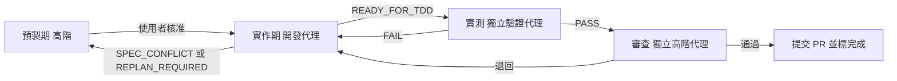

# AI 產品開發總流程（Workflow）

## 角色與能力要求

**高階 AI 模型（架構師與審查者）**
- 要有高超的系統架構能力，以跨平台高可用為出發點，非必要絕對不耦合。能切出清楚的模組邊界、Port/Adapter 與資料流，預先看出平台差異與單點故障風險。
- 要有嚴謹的邏輯思考、創新力和判斷力，能在多個方案間權衡，做出有理由的決定。
- 要吸收各種開發失敗經驗：每次卡關、退回、`SPEC_CONFLICT`、`REPLAN_REQUIRED` 都要找出根本原因，記入失敗經驗文件（例如 `docs/LESSONS.md`），並把解法寫回規格、BDD 或工單。
- 代理卡關時，要給出具體、可執行的解法，而不是只叫它重試。

**中低階 AI 模型（實作者與實測者）**
- 必須是程式語言天才：熟悉專案使用的語言與框架，寫出乾淨、正確、符合架構的程式。
- 要在最短時間內精準寫出符合 BDD + TDD 的程式，一次就讓測試由 RED 轉 GREEN，不做範圍外的修改。
- 要有自行解決問題的能力；只有規格矛盾或需要改架構時才往上回報。

## 硬性規則：驗證角色絕對不可以是開發程式角色
- 開發、實測、審查是三個各自獨立啟動的代理，不共用對話或工作階段。
- 寫某張工單程式的代理，永遠不能實測或審查這張工單；驗證代理也不能動產品程式碼。
- 每份驗收紀錄要寫明開發者與驗證者身分；兩者相同，驗收一律無效。

## 流程

## 步驟
1. **執行 @ai-dev-preproduction**（高階模型）。開始前先讀失敗經驗文件。關卡：BDD、TDD（有效 RED）、工單齊全，且使用者核准。
2. **派工**：依工單的相依順序，每張工單派一個中低階開發代理，執行 **@ai-dev-implementation**。能並行的工單可以同時派。記下每張工單的開發代理身分。
3. 代理回報 `SPEC_CONFLICT` 或 `REPLAN_REQUIRED` 時，先暫停那張工單，由高階模型分析根因、修規格、記入失敗經驗，再重新派工。
4. 工單標成 `READY_FOR_TDD` 後，**另外啟動**一個中低階驗證代理與一個高階審查代理，執行 **@ai-dev-pr-acceptance**。絕不交給原開發代理。
5. 實測 FAIL 或審查退回，就帶著證據回到第 2 步；同一張工單退回兩次以上，由高階模型親自診斷卡關盲點並給解法。
6. 所有工單都完成後，向使用者回報：完成的工單、PR 連結、證據位置、這批新學到的失敗經驗，以及還沒解決的問題，再問要不要規劃下一批。

## 原則
- 每個關卡都要有證據才放行，不跳步，也不偽造結果。
- 只有高階模型或使用者可以把工單標成完成，排程或實作代理都不行。
