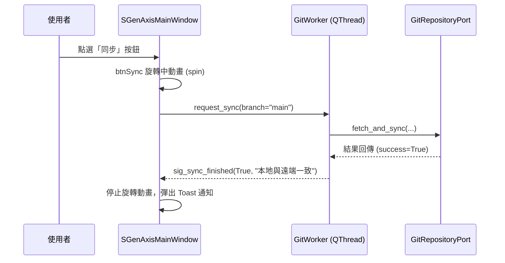

# SGenAxis Git 管理工作台 — C++ & PySide6 應用程式開發架構規格

> **用途**：本文檔將 `git_workbench_interactive.html` 視覺與互動原型，轉譯為未來使用 **C++ (Qt 6)** 與 **Python (PySide6)** 開發桌面應用程式之核心規格與工程藍圖。

---

## 1. 系統視覺與設計語彙 (Design Tokens)

延續 SGenAxis 專業 DCC 工作站深色設計規範（對應 `docs/ui-design/ui-spec.json`）：

| Token 名稱 | 色碼 / 數值 | 用途與說明 |
|---|---|---|
| `background` | `#101112` | 主視窗底色、無邊框標題列 |
| `panel` | `#1b1d1f` | 工作區與中央表格背景 |
| `panelRaised` | `#23262a` | 一般按鈕、浮動對話框表面 |
| `panelActive` | `#1e3a5f` | 選取高亮背景 (Selection Accent) |
| `border` | `#34383e` | 面板分割線、表格網格線 |
| `textPrimary` | `#eef0f3` | 標題與主要文字 |
| `textMuted` | `#aeb5bf` | 次要文字、欄位表頭 |
| `blue` | `#246bff` | 主要操作按鈕 (Sync / Commit)、作用中標籤 |
| `green` | `#5bc98b` | 綠燈 (已完成)、Diff 新增行高亮 |
| `red` | `#f07979` | 紅燈 (Bug / 阻斷)、Diff 刪除行高亮 |
| `yellow` | `#f2b544` | 黃燈 (進行中 / 待推播警示) |
| `fontSans` | `Segoe UI, Microsoft JhengHei` | UI 介面字體 |
| `fontMono` | `Cascadia Code, Consolas` | 分支名稱、Diff 代碼、時間戳記 |

---

## 2. 視窗組件階層對照 (Component Hierarchy)

```
QMainWindow (SGenAxisGitWindow)
├── MenuBar (QMenuBar - 桌面應用程式頂部主選單)
│   ├── Brand: SGenAxis
│   ├── Menus: 檔案 (File) | 編輯 (Edit) | 專案 (Project) | 模組 (Module) | 工項 (Tasks) | 視窗 (Window) | 說明 (Help)
│   └── WindowControls: (Min, Max, Close)
│
├── ContextToolBar (QToolBar - 專案導覽與快捷工具列)
│   ├── QLabel ("專案：")
│   ├── QComboBox (SGenAxis 下拉選單)
│   ├── QPushButton / QLineEdit (📁 D:\AutoCode 目錄框)
│   ├── QPushButton (ᛘ main 分支狀態鈕)
│   ├── Badges: [DRAFT 0.1 / 本機即時同步] [2026-10-10]
│   ├── QPushButton (btnSync - 同步)
│   ├── QToolButton (btnAddTask - 新增工項 ▾)
│   └── QPushButton (btnToggleArchitecture - Qt/PySide 對照)
│
├── CentralWidget (QSplitter [Horizontal])
│   │
│   ├── LeftSidebar (QFrame / QWidget - 固定 240px)
│   │   ├── CollapsibleSection 1: 🤖 Agent 派工 [0/1] (最上方)
│   │   ├── CollapsibleSection 2: Tasks Status (4色狀態燈號過濾器)
│   │   ├── CollapsibleSection 3: GIT 工具 (分支/歷史/同步/衝突清單)
│   │   ├── CollapsibleSection 4: 模組架構圖 (UI-04: DAG 畫布/Ports & Contracts)
│   │   ├── CollapsibleSection 5: UI 設計工具 (14 頁設計稿總覽/Tokens 色票)
│   │   └── CollapsibleSection 6: 📦 部署與統計 (最下方: 最近部署/期間統計/派工進度)
│   │
│   └── MainWorkspace (QStackedWidget / 多視圖切換容器)
│       ├── View 1: Git 版本控管工作台 (QTableView + Floating Overlays)
│       ├── View 2: 模組架構 DAG 畫布 (QGraphicsView - UI-04 拓撲圖)
│       └── View 3: UI 設計工具與 14 頁設計稿 (QScrollArea / QGridLayout)
│       ├── HeaderBar (QToolBar - 本地變更 ▾, 提交按鈕, Source 分支選單)
│       ├── TableView (QTableView - Git 檔案與工項清單)
│       │   ├── GitChangesModel (QAbstractTableModel)
│       │   └── GitTaskItemDelegate (QStyledItemDelegate - 燈號與 BDD/TDD Chip)
│       │
│       └── FloatingOverlays (子元件或無邊框 QDialog)
│           ├── LocalChangesPopover (QFrame - 暫存/未暫存多選清單)
│           ├── CommitChangesDialog (QDialog - 提交訊息輸入與送出)
│           └── BranchTreePanel (QGraphicsView - 分支 DAG 視覺化)
│
└── RightDockWidget (QDockWidget - 可停靠/浮動 390px)
    ├── CollapsibleSection: TaskInspector (工項標題、狀態、4組屬性開關)
    └── CollapsibleSection: DiffViewer (QPlainTextEdit + GitDiffHighlighter)
```

---

## 3. 六邊形架構 (Hexagonal Architecture / Port & Adapter)

遵循核心規範：**業務邏輯與 DCC / Git 底層解耦**。

```
┌─────────────────────────────────────────────────────────┐
│                       UI Layer                          │
│        PySide6 / C++ Qt (MainWindow, Models, Views)     │
└───────────────────────────┬─────────────────────────────┘
                            │ 調用 / 接收 Signals
┌───────────────────────────▼─────────────────────────────┐
│                    Core Service                         │
│            GitWorkbenchService (純邏輯，零 Qt)           │
└───────────────────────────┬─────────────────────────────┘
                            │ 依賴反轉
┌───────────────────────────▼─────────────────────────────┐
│                    Ports (契約協議)                      │
│            GitRepositoryPort (Protocol / ABC)           │
└───────────────────────────┬─────────────────────────────┘
                            │ 實作
       ┌────────────────────┴────────────────────┐
       ▼                                         ▼
[ QProcessGitAdapter ]                  [ LibGit2Adapter ]
(透過本機 git CLI 調用)                   (高效能 C++ C-API 綁定)
```

### Port 介面定義 (Python Protocol 範例)
```python
from typing import Protocol, List
from dataclasses import dataclass

@dataclass(frozen=True)
class GitStatusResult:
    branch: str
    staged_files: List[str]
    unstaged_files: List[str]
    is_clean: bool

class GitRepositoryPort(Protocol):
    def get_status(self, repo_path: str) -> GitStatusResult: ...
    def stage_file(self, repo_path: str, file_path: str) -> None: ...
    def commit_and_push(self, repo_path: str, message: str, files: List[str]) -> bool: ...
    def fetch_and_sync(self, repo_path: str, branch: str) -> bool: ...
```

---

## 4. 信號與槽事件流 (Signals & Slots Schema)

桌面端必須維持 UI 響應性，所有 Git I/O 皆使用 `QThread` 背景運行：



---

## 5. C++ Qt 類別宣告原型 (Header Preview)

### `GitChangesModel.h`
```cpp
#pragma once
#include <QAbstractTableModel>
#include <QVector>

struct GitTaskItem {
    QString taskId;
    QString title;
    QString status;      // "red", "green", "yellow", "gray"
    QString createdAt;
    QString completedAt;
    QString remarks;
    QStringList tags;    // {"BDD", "TDD"}
    bool isChecked = false;
};

class GitChangesModel : public QAbstractTableModel {
    Q_OBJECT
public:
    explicit GitChangesModel(QObject *parent = nullptr);
    int rowCount(const QModelIndex &parent = QModelIndex()) const override;
    int columnCount(const QModelIndex &parent = QModelIndex()) const override;
    QVariant data(const QModelIndex &index, int role = Qt::DisplayRole) const override;
    bool setData(const QModelIndex &index, const QVariant &value, int role = Qt::EditRole) override;
    Qt::ItemFlags flags(const QModelIndex &index) const override;
    QVariant headerData(int section, Qt::Orientation orientation, int role = Qt::DisplayRole) const override;

    void updateTasks(const QVector<GitTaskItem> &newTasks);

private:
    QVector<GitTaskItem> m_tasks;
    QStringList m_headers;
};
```

### `GitDiffHighlighter.h`
```cpp
#pragma once
#include <QSyntaxHighlighter>
#include <QTextCharFormat>

class GitDiffHighlighter : public QSyntaxHighlighter {
    Q_OBJECT
public:
    explicit GitDiffHighlighter(QTextDocument *parent = nullptr);

protected:
    void highlightBlock(const QString &text) override;

private:
    QTextCharFormat m_hunkFormat;
    QTextCharFormat m_addFormat;
    QTextCharFormat m_delFormat;
};
```

---

## 6. QSS 樣式表實作清單 (Production QSS)

可直接嵌入應用程式資源檔 `resources/styles/dark_theme.qss`：

```css
/* SGenAxis Dark Workstation QSS */
QMainWindow {
    background-color: #101112;
    color: #eef0f3;
}

QSplitter::handle {
    background-color: #34383e;
    width: 1px;
}

QTableView {
    background-color: #1b1d1f;
    border: 1px solid #34383e;
    gridline-color: #2b2f36;
    selection-background-color: rgba(36, 107, 255, 0.25);
    selection-color: #ffffff;
}

QTableView::item:hover {
    background-color: rgba(40, 44, 50, 0.7);
}

QHeaderView::section {
    background-color: #151719;
    color: #aeb5bf;
    padding: 6px;
    border: none;
    border-bottom: 1px solid #34383e;
    font-weight: 600;
}

QPushButton {
    background-color: #23262a;
    border: 1px solid #34383e;
    border-radius: 3px;
    color: #eef0f3;
    padding: 5px 12px;
}

QPushButton:hover {
    background-color: #282c32;
    border-color: #444952;
}

QPushButton:pressed {
    background-color: #1a1c20;
}

QPushButton#btnPrimary {
    background-color: #246bff;
    border-color: #1e5ad9;
    color: #ffffff;
    font-weight: 600;
}

QPushButton#btnPrimary:hover {
    background-color: #3b7cff;
}

QPlainTextEdit#diffEditor {
    background-color: #0d0e10;
    border: 1px solid #34383e;
    font-family: "Cascadia Code", Consolas, monospace;
    font-size: 11px;
    color: #eef0f3;
}
```

---

## 6. DCC 桌面應用程式風格系統 (QMenuBar & QToolBar Blueprint & Tokens)

為確保未來以 C++ (Qt 6) 與 PySide6 開發時完全傳承 SGenAxis 專業 DCC 軟體工作站風格，頂部區域統一採用雙層結構（Tier 1: QMenuBar + Tier 2: QToolBar）：

### 6.1 視覺層次與 Tokens

| 組件層級 | 對應 Qt 類別 | 背景色碼 | 邊框與樣式 | 內部元素 |
|---|---|---|---|---|
| **Tier 1: 主選單列** | `QMenuBar` / `QMenu` | `#101215` (消光炭灰) | 底部 `1px solid #1c2026` | 標題 `SGenAxis` + 7 大選單 (`檔案`, `編輯`, `專案`, `模組`, `工項`, `視窗`, `說明`) + 視窗控制鈕 |
| **Tier 2: 快捷工具列** | `QToolBar` | `#14171c` (深灰底面板) | 底部 `1px solid #34383e` | `專案：` 標籤、`QComboBox` 專案選單、`📁 D:\AutoCode` 路徑框、`ᛘ main` 分支鈕、同步與工項按鈕 |
| **下拉式清單表面** | `QMenu` / `QComboBox QAbstractItemView` | `#181b22` / `#1a1d24` | `1px solid #2e3442`，圓角 `4px` | 選中高亮 `#246bff`，文字 `#ffffff`，快捷鍵提示 `#8b949e` |

### 6.2 C++ (Qt 6) 實作範例

```cpp
// SGenAxisMainWindow.cpp
void SGenAxisMainWindow::setupTopNavigation() {
    // 1. QMenuBar 主選單
    QMenuBar* menuBar = this->menuBar();
    QMenu* fileMenu = menuBar->addMenu(tr("檔案"));
    fileMenu->addAction(tr("新增專案 (Ctrl+N)"), this, &SGenAxisMainWindow::onNewProject);
    fileMenu->addAction(tr("開啟專案... (Ctrl+O)"), this, &SGenAxisMainWindow::onOpenProject);
    fileMenu->addSeparator();
    fileMenu->addAction(tr("儲存變更 (Ctrl+S)"), this, &SGenAxisMainWindow::onSaveState);

    QMenu* editMenu = menuBar->addMenu(tr("編輯"));
    QMenu* projMenu = menuBar->addMenu(tr("專案"));
    QMenu* modMenu = menuBar->addMenu(tr("模組"));
    QMenu* taskMenu = menuBar->addMenu(tr("工項"));
    QMenu* winMenu = menuBar->addMenu(tr("視窗"));
    QMenu* helpMenu = menuBar->addMenu(tr("說明"));

    // 2. QToolBar 快捷導覽列
    QToolBar* toolbar = this->addToolBar(tr("專案快捷導覽列"));
    toolbar->setMovable(false);

    QLabel* lblProj = new QLabel(tr(" 專案： "), this);
    toolbar->addWidget(lblProj);

    QComboBox* comboProj = new QComboBox(this);
    comboProj->addItems({"SGenAxis", "AutoRig_Core", "MayaPipeline_v2", "HoudiniDCC_Tools"});
    toolbar->addWidget(comboProj);

    QPushButton* btnPath = new QPushButton(tr("📁 D:\\AutoCode"), this);
    toolbar->addWidget(btnPath);

    QPushButton* btnBranch = new QPushButton(tr("ᛘ main"), this);
    btnBranch->setObjectName("btnBranch");
    toolbar->addWidget(btnBranch);

    QWidget* spacer = new QWidget(this);
    spacer->setSizePolicy(QSizePolicy::Expanding, QSizePolicy::Preferred);
    toolbar->addWidget(spacer);

    QPushButton* btnSync = new QPushButton(tr("🔄 同步"), this);
    btnSync->setObjectName("btnPrimary");
    toolbar->addWidget(btnSync);
}
```

---

*文檔版本: v1.2.0 | 更新日期: 2026-10-10 | 對應視覺原型: git_workbench_interactive.html & media_1791636668969_a562558b.png*

## 7. 驗證與執行方式

1. **互動式 HTML 原型**：
   - 檔案位置：`d:\AIAD\git_workbench_interactive.html`
   - 使用任意瀏覽器開啟即可進行全功能點選、彈出視窗切換、Diff 檢視、篩選過濾與架構規格瀏覽。
2. **Python PySide6 原生腳本**：
   - 檔案位置：`d:\AIAD\sgenaxis_git_workbench.py`
   - 執行命令：`python d:\AIAD\sgenaxis_git_workbench.py` (在具備 PySide6 之 Python 環境下)。
